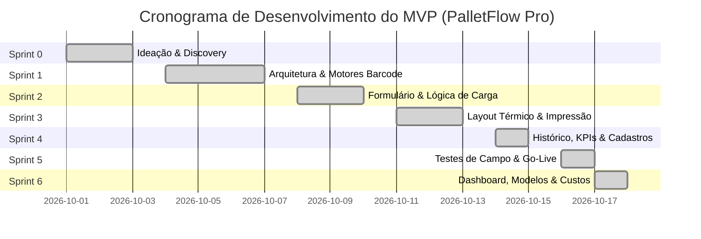

# Planejamento de Sprints — Do Conceito ao MVP
## Projeto: PalletFlow Pro (Controle de Paletes & Expedição de Volumes)

Este documento descreve o ciclo completo de desenvolvimento ágil do sistema **PalletFlow Pro**, desde a fase inicial de ideação e levantamento de necessidades até a entrega do MVP (*Minimum Viable Product*) operacional e funcional.

---

## 🎯 Visão do Produto & Definição de MVP

> **Declaração de Visão:**  
> Proporcionar um sistema ágil, autônomo e de alta confiabilidade para emissão de etiquetas de paletes e romaneios de transferência entre lojas, garantindo rastreabilidade total, leitura rápida nas docas e eliminação de extravios de carga.

### Escopo Crítico do MVP:
1. **Seleção da Loja de Destino** (Transferência rápida).
2. **Quantidade de Paletes** com desdobramento sequencial automático (**Volume 01/N a N/N**).
3. **Identificação do Conferente** responsável pela liberação.
4. **Data da Expedição** com registro cronológico.
5. **Placa do Veículo** com máscara e validação Mercosul/Convencional.
6. **Formato de 2 Etiquetas por Folha A4** com linha de corte tracejada central (`✂️ LINHA DE CORTE`) e suporte a rolo térmico 100x150mm.
7. **Fotos dos Volumes Carregados no Histórico de Romaneio:**
   - Botão e modal para anexar/capturar fotos da carga posicionada no caminhão.
   - Compressão automática via `<canvas>` para economia de espaço.
   - Visualização ampliada (lightbox) e exclusão.
   - Inclusão das fotos como anexo visual no Romaneio/Manifesto impresso.
8. **Romaneio / Manifesto de Carga A4** para assinatura do motorista e conferente.
9. **Histórico Local e Reimpressão** com 1 clique.

---

## 📅 Linha do Tempo das Sprints

---

## 🏃 Detalhamento das Sprints

### 📌 Sprint 0: Ideação, Discovery e Diagnóstico Operacional
*Duração: 3 dias | Foco: Entendimento da dor, requisitos e viabilidade técnica.*

- **Objetivos:**
  - Mapear os gargalos da operação de expedição e transferência entre filiais.
  - Entender os equipamentos disponíveis no galpão (impressoras térmicas Zebra/Elgin de 100x150mm, leitores laser, coletores Android).
  - Definir a premissa de **Zero Dependências Externas** (operação 100% offline para evitar paradas na doca).
- **Histórias de Usuário:**
  - *Como conferente de expedição*, quero poder emitir etiquetas de palete em menos de 30 segundos para não atrasar o carregamento dos caminhões.
  - *Como motorista de transferência*, preciso saber com clareza para qual loja cada palete do caminhão pertence sem precisar rasgar o filme stretch.
- **Entregáveis da Sprint:**
  - Documento de Requisitos e Dores atendidas.
  - Definição da stack: HTML5, CSS3 puro, Vanilla JS, Node.js nativo para o servidor local.
  - Especificação física da etiqueta de palete (100mm × 150mm).

---

### 📌 Sprint 1: Arquitetura Base, Design System e Motores Offline
*Duração: 4 dias | Foco: Fundação técnica, vetores de código de barras e QR Code.*

- **Objetivos:**
  - Criar o servidor HTTP local sem dependências externas via [server.js](file:///e:/Projeto%20Novo/server.js).
  - Implementar o algoritmo de Código de Barras Code-128 em SVG vetorial nativo via [js/barcode.js](file:///e:/Projeto%20Novo/js/barcode.js).
  - Implementar o gerador nativo de QR Code offline em [js/qrcode.js](file:///e:/Projeto%20Novo/js/qrcode.js).
  - Criar o Design System de alto contraste e tema escuro industrial em [css/style.css](file:///e:/Projeto%20Novo/css/style.css).
- **Critérios de Aceite:**
  - Códigos de barras gerados em vetor nítido, sem borrões em impressoras de 203 DPI ou 300 DPI.
  - QR Code contendo os metadados da carga legível por câmeras de celular sem conexão de internet.
- **Entregáveis da Sprint:**
  - `server.js`, `package.json`, `js/barcode.js`, `js/qrcode.js`.

---

### 📌 Sprint 2: Formulário de Expedição & Lógica de Carga
*Duração: 3 dias | Foco: Experiência de uso, preenchimento ágil e regras de validação.*

- **Objetivos:**
  - Montar a interface principal em [index.html](file:///e:/Projeto%20Novo/index.html).
  - Integrar os seletores de **Loja de Destino** e **Nome do Conferente**.
  - Desenvolver o componente numérico de paletes com pílulas de atalho (`1`, `2`, `4`, `8`, `12`, `24 paletes`).
  - Implementar máscara e validação em tempo real para placas Mercosul (`ABC1D23`) e modelo padrão (`ABC-1234`).
  - Preenchimento automático da data do dia e geração do código único do lote (`EXP-AAAAMMDD-001`).
- **Critérios de Aceite:**
  - Ao alterar a quantidade de paletes de 1 para 5, o sistema deve instantaneamente gerar 5 etiquetas sequenciais (**01/05** a **05/05**) com identificadores únicos.
  - Placa automaticamente convertida para caixa alta e formatada.
- **Entregáveis da Sprint:**
  - Estrutura de formulário funcional e reativa em [js/app.js](file:///e:/Projeto%20Novo/js/app.js).

---

### 📌 Sprint 3: Calibração de Impressão Térmica (100x150mm) e Romaneio A4
*Duração: 3 dias | Foco: Qualidade da impressão física e documentos de transporte.*

- **Objetivos:**
  - Configurar as regras CSS `@media print` para corte e quebra exata de página por palete (`break-after: page`).
  - Criar o layout da etiqueta com o nome da loja em **letras gigantes e negrito** (visibilidade superior a 10 metros de distância).
  - Adicionar o botão de **"Imprimir Avulso"** em cada etiqueta para reposição rápida de etiquetas rasgadas ou molhadas.
  - Desenvolver o layout do **Romaneio de Carga / Manifesto A4** com tabela de checklist de todos os paletes e assinaturas do conferente, motorista e recebedor.
- **Critérios de Aceite:**
  - Na impressão, todos os botões, cabeçalhos do navegador e menus devem ser 100% ocultados.
  - Cada palete ocupa exatamente uma etiqueta térmica sem saltar páginas em branco.
- **Entregáveis da Sprint:**
  - Regras completas de impressão em [css/style.css](file:///e:/Projeto%20Novo/css/style.css) e renderizador em [js/app.js](file:///e:/Projeto%20Novo/js/app.js).

---

### 📌 Sprint 4: Persistência de Dados, Histórico e Gerenciador de Cadastros
*Duração: 2 dias | Foco: Rastreabilidade, métricas e gestão de unidades.*

- **Objetivos:**
  - Criar a camada de persistência no navegador via [js/storage.js](file:///e:/Projeto%20Novo/js/storage.js).
  - Implementar a aba **Histórico & Romaneios** com busca textual por lote, loja, conferente ou placa.
  - Implementar os cards de métricas (KPIs):
    - *Paletes Expedidos Hoje*
    - *Veículos Despachados*
    - *Lojas Atendidas*
    - *Cargas em Trânsito*
  - Criar a aba **Lojas & Conferentes** para inclusão, edição e remoção de unidades da rede.
  - Botão de reimpressão imediata de qualquer remessa anterior.
- **Critérios de Aceite:**
  - Recarregar a página não perde as expedições já realizadas nem o cadastro de lojas.
  - Reimpressão de lotes antigos mantém a mesma numeração e código de barras original.
- **Entregáveis da Sprint:**
  - Módulo [js/storage.js](file:///e:/Projeto%20Novo/js/storage.js) e visualização de histórico completa.

---

### 📌 Sprint 5: Testes de Campo, Homologação e Go-Live do MVP
*Duração: 2 dias | Foco: Validação prática no ambiente de expedição.*

- **Atividades Executadas:**
  - Testes com scanners de código de barras e celulares com o volume embalado em plástico stretch.
  - Teste de desempenho: geração de lotes com 24 a 50 paletes em menos de 100 milissegundos.
  - Criação da documentação técnica e operacional:
    - [README.md](file:///e:/Projeto%20Novo/README.md)
    - [contexto.md](file:///e:/Projeto%20Novo/contexto.md)
    - [sprints.md](file:///e:/Projeto%20Novo/sprints.md)
  - Homologação final e disponibilidade em `http://localhost:3000`.

---

### 📌 Sprint 6: Dashboard Analítico de Saldo, Gráficos Interativos & Gestão de Custo
*Duração: 2 dias | Foco: Visibilidade executiva de estoque, gráficos em tempo real, modelos físicos e valor patrimonial.*

- **Objetivos:**
  - Criar a aba dedicada **📊 Dashboard & Saldo** com Design System industrial executivo (Glassmorphism e gradientes neon).
  - Integrar o motor gráfico **Chart.js** localmente (`js/chart.umd.min.js`) com funcionamento 100% offline.
  - Implementar 5 gráficos interativos de alta fidelidade:
    1. **Fluxo Temporal Diário de Paletes (Área Spline com Gradiente):** Saídas vs. Entradas com alternador de visão (Unidades vs. R$).
    2. **Rosca de Composição por Modelo (Doughnut Cutout 72%):** PBR, Descartável e CHEP com totalizador central e legenda customizada.
    3. **Ranking de Veículos (Barras Horizontais):** Paletes transportados e valor faturado por placa de veículo.
    4. **Distribuição por Loja de Destino (Barras Verticais):** Volume de paletes alocados em cada filial.
    5. **Indicador de Auditoria & Conferência (Gauge Circular):** Taxa percentual de acurácia de recebimento.
  - Implementar o cálculo dinâmico de **Saldo de Estoque** (`Saldo = Inicial + Entradas - Saídas`).
  - Suporte completo aos modelos de palete: **PBR**, **Descartável** e **CHEP**, com cores e badges visuais distintos.
  - Implementar valorização patrimonial com base na tabela homologada: **PBR (R$ 89,90)**, **Descartável (R$ 59,90)** e **CHEP (R$ 100,90)** com ticker banner financeiro.
  - Criar o fluxo e modal de **Registro de Retorno / Entrada de Paletes** devolvidos pelas lojas para o CD com histórico auditável.
- **Critérios de Aceite:**
  - Todos os 5 gráficos renderizam de forma fluida e responsiva com tooltips ricos contendo unidades e valores em R$.
  - Cada expedição de carga diminui o saldo do modelo selecionado e cada retorno de loja aumenta o saldo correspondente.
  - O valor em Reais (R$) é recalculado instantaneamente pelo preço homologado do modelo (PBR: R$ 89,90, Descartável: R$ 59,90, CHEP: R$ 100,90).
- **Status do MVP:** **Entregue e Operacional ✅**

---

## 🔮 Backlog Pós-MVP (Evoluções Futuras)

| Épico / Funcionalidade | Descrição | Prioridade |
| :--- | :--- | :--- |
| **Baixa por Coletor na Loja Destino** | Tela responsiva para conferência do palete recebido na loja com leitura do QR Code. | Alta |
| **Integração com ERP (TOTVS, SAP, Bling, etc.)** | Endpoint REST ou importação de XML de NF-e para preencher loja, placa e volumes automaticamente. | Média |
| **Notificação Automática no WhatsApp** | Disparo de aviso ao gerente da filial informando placa, conferente e previsão de chegada da carga. | Média |
| **Relatórios em PDF e Excel** | Exportação de relatórios mensais de movimentação de paletes e faturamento de custos. | Baixa |
